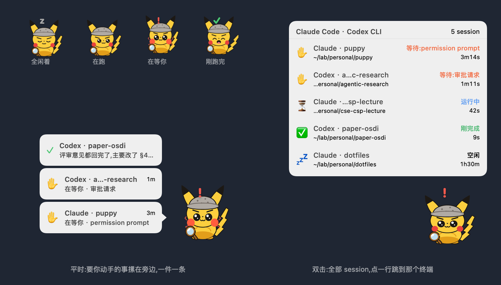

# Puppy

一只悬浮在桌面上的小宠物,实时反映 iTerm2 里每个 Claude Code session 的状态。
形象是一套可替换的贴图 —— 内置的那只只是默认值,换成你自己的猫、你的头像、一个纯色方块都行。

[](https://www.apple.com/macos/)
[](https://swift.org)
[](https://iterm2.com)

[English](../README.md)



## 目录

- [这是个什么东西](#这是个什么东西)
- [装上它](#装上它)
- [用起来](#用起来)
- [再往下读](#再往下读)
- [参与](#参与)
- [许可](#许可)

## 这是个什么东西

并行开着五六个 Claude Code 的时候,真正的问题不是「跑得慢」,而是**某一个卡在权限确认上
等了你二十分钟而你不知道**。Puppy 把这件事挪到桌面角落:一个不占 Dock、不发通知的小图标,
它的动作就是全局状态,身边那摞气泡就是待办清单,点一下直接把你送回那个终端。

一眼就能看出哪个 session 在等你:它睡觉 = 全空闲,左顾右盼 = 有活在跑,炸毛乱跳 = 有人
卡在权限确认上等你回话。要你动手的事在它身边摞成一叠,一件一条,不轮播也不互相顶掉;
点气泡或列表里的任意一行,直接跳到对应的 iTerm2 窗口 / 标签页。它不发系统通知,也不出声。

它长什么样是你的事。app 只认四个状态(睡觉 / 在跑 / 等你 / 刚完成),每个状态配一条
帧动画;至于那四条动画画的是什么,由当前选中的皮肤决定,仓库里带的只是一套能直接跑的默认值。

它读的是 Claude Code CLI 自己维护的实时注册表(`~/.claude/sessions/<pid>.json`,一个运行中的
进程一个文件),**不碰** `~/.claude/projects/` 下动辄十几 MB 的 transcript。装上可选的
Stop hook 之后,「跑完了」还会换成那一轮真正的结论。原理和取舍写在
[DESIGN.md](DESIGN.md)。

全程 FSEvents 事件驱动,一处轮询都没有:实测全空闲时 0% CPU,动画真在播的时候约 3%。
[这么做换来了什么、代价是什么](DESIGN.md#省电)。

**要求:** macOS 14+、Swift 6 工具链(Xcode 或 Swift toolchain)、iTerm2。
跳转靠 iTerm2 的 AppleScript 接口,别的终端拿不到窗口,只会把 iTerm 提到前台。

## 装上它

```bash
git clone https://github.com/wxdwfc/Claude-puppy.git
cd Claude-puppy
make run      # 构建 .app、签名、启动(会先杀掉已在跑的实例)
```

`make stop` 退出。默认贴图靠 Pillow 生成,没装也照样起得来,退回编译进二进制的像素版。

### 建一个签名证书(强烈建议)

默认退回 ad-hoc 签名,能跑,但**每次重新编译签名指纹都会变**,导致「Puppy 想控制 iTerm2」
的授权反复失效 —— 每次点 session 行都要重新授权一次。建一个自签证书就能一劳永逸:

1. 打开「钥匙串访问」→ 菜单「证书助理」→「创建证书…」
2. 名称填 `puppy-dev`,身份类型「自签名根证书」,证书类型「代码签名」
3. `make run` 重新构建 —— 脚本会自动认出它并用它签名

第一次点某个 session 行时,系统会弹一次 Automation 授权,同意即可。
如果误点了拒绝,Puppy 会把你送到「系统设置 → 隐私与安全性 → 自动化」。

### 可选:让气泡说人话

```bash
make hook       # 装 Stop hook,写进 ~/.claude/settings.json(先留一份 .bak)
make unhook     # 卸干净,不留渣
```

装之前气泡只说「跑完了」;装之后它说那一轮的结论:

```
╭─────────────────────────────╮
│ ✓ agentic-research        1m │
│ 补上了缺的重试逻辑,测试全过   │
╰─────────────────────────────╯◀ ⚡
```

对所有项目生效,**新开的 session 才算数**,已经开着的要重启。这条通道被关在纯装饰层里:
摘要没配上就退回「跑完了」,状态判定永远不受影响 ——
[为什么不干脆全用 hook](DESIGN.md#stop-hook-干的那件事)。

## 用起来

### 支使它

| 操作 | 结果 |
|---|---|
| **单击** | 换窝:蹲到当前屏幕的下一个角(右下 → 左下 → 左上 → 右上 → …) |
| **双击** | 展开 / 收起 session 列表 |
| **拖动** | 放到任意位置 |
| **右键** | 展开列表 / 刷新 / 回到默认位置 / 换形象 / 退出 |

它没有 Dock 图标,**右键它**是唯一的退出入口。

挡住东西的时候不用瞄准拖 —— 点一下就扒拉到隔壁角去了,位置都会记住。被拖到半空中时,
第一下单击是先归位到最近的角,再往下轮转。双击的第一下会先跳一格,列表打开前它自己会跑回来。

### 它在说什么

| 样子 | 意思 |
|---|---|
| 闭眼呼吸 + 飘 `z` | 全部空闲,或者一个 session 都没有 |
| 左顾右盼 + 轻微起伏 | 有 session 在跑 |
| 炸毛 + 上下跳 + 红色 `!` | **有 session 在等你**(输入 / 权限确认) |
| 咧嘴笑 + 蹦跶 + 绿色 `✓` | 刚有一轮任务跑完,而且别的都闲着(10 秒) |
| 右上角绿色 `✓` 徽标 | 刚有一轮任务跑完,但还有别的 session 在跑 / 在等你(10 秒) |

身体动画的优先级是 `等待 > 运行 > 刚完成 > 睡觉`,所以只要有任何一个 session 卡在等你,
它一定在跳。「刚完成」不参与这个竞争 —— 它是挂在右上角的**独立徽标**,并行开好几个 session 时
不会被还在跑的那些吃掉。徽标和红色 `!` 落在皮肤各自指定的位置上,两个可以同时出现、不打架。
上面那栏动作写的是默认形象,换套皮肤动作就变了,状态本身不变。

### 身边那摞气泡

光靠头顶 6pt 的符号太容易漏,所以需要你动手的事会摞在它旁边,一件一条:

```
╭──────────────────────╮
│ ✋ agentic-research   3m │   ← 等最久的贴着它
│ 在等你 · permission prompt │
╰──────────────────────╯◀ ⚡
```

- **等最久的贴着它**,往上依次递减。处理完最紧急的,下一个自动滑到嘴边。
- 最多 5 条,再多折成一条 `还有 N 个 ›`,点它开完整列表。
- **点一下** = 跳到那个 session 的 iTerm 窗口。注意跳过去**不会**让它消失,
  你没真回答它就还在 —— 没有「已读」按钮,所以不可能出现「关掉了但其实忘了处理」。
- 「跑完了」那种没有后续动作,60 秒后自消。
- 默认开在左边,左边挤不下就翻到右边;点开列表面板时整摞让位。

这摞东西是当前状态的直接映射而不是一串会过期的通知,为什么这么设计见
[DESIGN.md](DESIGN.md#状态是从哪来的)。

### 换成你自己的形象

往 `~/.puppy/skins/` 里丢一个目录,**右键 → 形象**里就会列出来(每次拉开菜单都重扫,
不用重启)。一个形象 = 四张帧条 PNG(一个状态一张)+ 一份 `skin.json`:

```bash
./.build/debug/Puppy --export-skin ~/.puppy/skins/my-cat   # 导出默认那套作模板,照着改最省事
./.build/debug/Puppy --render /tmp/px --skin my-cat        # 装上去之前先渲出来看
```

`skin.json` 里除了帧率,还要告诉 app 气泡尾巴该指向哪一行、`!` 和 `✓` 徽标各落在哪 ——
这样贴图换成什么比例都对得上。字段说明和逐帧起伏的写法见 [SKINS.md](SKINS.md)。

仓库自带一套矢量生成的默认贴图(`make skin`),没手动选过形象时就用它。

### 命令行(调试用)

```bash
make list                    # 打印当前 session 表 + 气泡栈
make watch                   # 持续打印状态变化(FSEvents 驱动)
make shot                    # 重新生成上面那张 README 配图(离屏渲,不需要截屏授权)
./.build/debug/Puppy --focus <pid>                 # 单独验证 pid → tty → iTerm2 跳转
./.build/debug/Puppy --render <dir> [--skin <id>]  # 把每个状态的每一帧渲染成 PNG
./.build/debug/Puppy --skins                       # 列出可用皮肤
```

## 再往下读

- [DESIGN.md](DESIGN.md) —— 状态怎么推导出来的、Stop hook 的取舍、
  park 到后台那一轮怎么救回来、省电、已知的坑
- [SKINS.md](SKINS.md) —— 自己画一只
- [PLAN.md](../PLAN.md) —— 最初的设计草稿

## 参与

Issue 和 PR 都欢迎,尤其是这几类:

- **注册表 schema 漂了。** `~/.claude/sessions/` 里出现了没见过的字段或 status,
  贴一份(记得抹掉路径里的敏感信息)。
- **你画的皮肤。**
- **别的终端。** 现在只有 iTerm2 能精确跳转,别的终端拿不到 tty 匹配。

这是个人玩具项目,按周末的节奏合并,别指望 SLA。

## 许可

MIT,全文见 [LICENSE](../LICENSE)。
